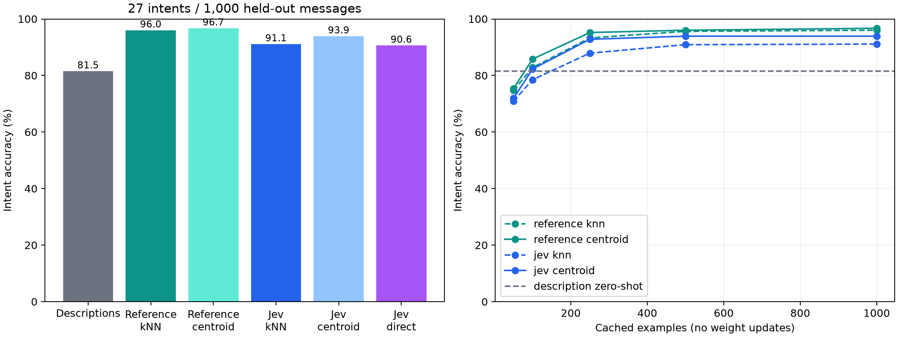

# Jevの分類を見本にする、学習なしの問い合わせ振り分け実験

これは予備実験です。主指標をJevとの一致率に定め、新しいテスト10,000件と
見本500・1,000・2,000件で比較した[本実験レポート](../bitext-paper/README.md)を参照してください。

2026-10-08実行。**Jevでラベルを付けた1,000件をEmbeddingGemma 2で埋め込み、
カテゴリごとに平均すると、別の1,000件で既存ラベルとの一致率93.9%となった。**
候補説明文だけの81.5%から12.4ポイント改善した。
この方式とJevの直接判定の一致率は**89.6%**である。
93.9%はJevの再現率や、Jevとの一致率ではない。

## 何と比較したか

入力は[Bitext Customer Support](https://huggingface.co/datasets/bitext/Bitext-customer-support-llm-chatbot-training-dataset)
の英語の合成問い合わせ。短い問い合わせ文の27分類で、完全なメールではない。
評価の基準はデータセットに含まれる既存のintentラベルで、今回人が検証した正解ではない。
大分類はCSVに実在する11カテゴリを使った。

| 方法 | 27分類の既存ラベルとの一致率 | Macro F1 | 11大分類の一致率 | Jev直接判定との一致率 |
| --- | ---: | ---: | ---: | ---: |
| EmbeddingGemma 2＋候補説明文のみ | 81.5% | 0.8064 | 90.7% | 79.0% |
| 既存ラベルの見本＋近傍検索 | 96.0% | 0.9551 | 98.8% | 87.8% |
| 既存ラベルの見本＋カテゴリ平均 | 96.7% | 0.9614 | 99.6% | 89.2% |
| Jevラベルの見本＋近傍検索 | 91.1% | 0.8979 | 95.7% | 89.6% |
| **Jevラベルの見本＋カテゴリ平均** | **93.9%** | **0.9296** | **98.0%** | **89.6%** |
| Jevがテスト入力を直接分類 | 90.6% | 0.8971 | 95.9% | 100.0% |



Jevの見本ラベルは既存ラベルと91.8%一致した。Jevの付けたラベルを使うカテゴリ平均方式は、
各分類の平均Embeddingを作るだけで、モデルへの逆伝播・追加ヘッド・重みの更新は行っていない。
見本を使うため、分類方式としては追加学習のないfew-shot方式である。

## 処理の中身

事前準備:

1. 既存データからランダムに問い合わせ1,000件を抽出する。
2. Jevへ**問い合わせ本文だけ**を送り、定義した27候補から分類させる。
3. その元の問い合わせ本文をEmbeddingGemma 2でEmbeddingにする。
4. Jevが同じ分類を付けたベクトルを平均し、長さ1に正規化する。

判定時:

1. 新しい問い合わせをEmbeddingGemma 2に**1回**通す。
2. 27個のカテゴリ平均とのコサイン類似度をまとめて計算する。
3. 最も近い分類IDを返す。Jev APIは呼ばない。

Embeddingするのは元の問い合わせ文であり、Jevの出力JSONではない。
Jevの出力は見本を分類するために使う。
近傍検索方式では平均せず、最も近い複数の見本のラベルを相対重み付きで投票する。
類似度や投票重みは、校正済みの正解確率ではない。

## 分割と設定の決め方

- データセットのコミットは`430d1a89bd93bd1fa23c16f29dd53e73f0087443`に固定。
- 26,872行をUnicode正規化・大小文字統一・句読点除去・プレースホルダ正規化で重複排除。
  23,826件が残り、同じ正規化本文でラベルが矛盾するグループは0件だった。
- seed 42で、見本1,000件、調整用500件、テスト1,000件を先に確定した。
- 文字3〜5-gramのTF-IDF類似度0.90以上の近似文を分割境界で除外。
  調整用は見本と比較して31件、テストは見本＋調整用と比較して121件を除外した。
  このTF-IDFは分割だけに使い、分類器には使わない。
- Embedding/API入力は`instruction`列のみ。回答文・intent・categoryは入力に含めない。
- 説明文27個とJevへの判断指示は固定し、テストを見て書き直していない。
- 近傍数`1/3/5/9/15`、投票温度`0.03/0.07/0.1/0.2`は調整用データのMacro F1で選択。
  既存ラベルは`k=5, T=0.03`、Jevラベルは`k=15, T=0.1`になった。
- Jev近傍検索とJevカテゴリ平均の選択にも調整用Macro F1を使用。
  それぞれ0.9026、0.9489で、カテゴリ平均を採用した。
  比較表には選択にかかわらず全方式を掲載した。

分割ID、ラベル数、説明文、元CSVのSHA-256は[manifest.json](manifest.json)、
テスト各行の予測は`predictions.csv`（ローカルのみ）、詳細指標は[results.json](results.json)に保存した。
本文・全データセット・行ごとの予測・APIキー・API生レスポンスはGitに含めていない。
データセットのライセンスはCDLA-Sharing-1.0。本文は提供元からダウンロードする。

## 見本は何件必要だったか

同じランダム順序の先頭部分を使った、入れ子の見本集合。各近傍検索設定は調整用で選択した。
1回の抽出であり、異なるseedでの平均ではない。

| Jevで分類した見本件数 | 近傍検索の一致率 | カテゴリ平均の一致率 |
| ---: | ---: | ---: |
| 50 | 70.9% | 71.9% |
| 100 | 78.5% | 82.3% |
| 250 | 87.9% | 92.8% |
| 500 | 90.9% | 93.9% |
| 1,000 | 91.1% | 93.9% |

このデータと抽出では、カテゴリ平均方式は250〜500件で改善がほぼ頭打ちになった。
各分類の比率・見本の多様性で必要件数は変わる。
[support_size_curve.csv](support_size_curve.csv)に全設定の結果を保存した。

## 間違いと指標の意味

カテゴリ平均方式の主な誤分類は、請求書の確認→請求書の取得12件、
返金要求→返金規定の確認6件、新規配送先の設定→既存配送先の変更5件だった。
Jevの見本ラベルでは、配送予定と配送状況の混同も多かった。

カテゴリ平均がJevの直接判定より既存ラベルに一致したことから、
「Jevより一般に賢いモデル」とは結論できない。
見本の集約で個々のラベル誤りの影響が薄まった可能性と、
合成データの言い回し・ラベル体系を類似度方式が捉えやすい可能性がある。
これは原因を切り分けた実験ではない。

カテゴリ平均と説明文のみの一致率差は+12.4ポイント。
テスト例を対にしたbootstrap 5,000回の95%区間は+10.0〜+14.8ポイント。
これはこのテスト集合の標本変動だけを示し、他分野への汎化や教師ラベルの正しさは保証しない。

保留も調整用データで検証した。カテゴリ平均で上位2候補の類似度差が
`0.0207543`以上の例だけ採用すると、テスト858件（85.8%）で既存ラベルとの一致率97.44%。
残り142件を保留する。調整用での目標98%がテストでも保たれたわけではない。
近傍検索では564件（56.4%）を採用して99.65%だった。
保留設定を使わない比較表の数字と混同しないこと。

## サイズ・速度・料金

- モデル: EmbeddingGemma 2のtext-only構成、768次元、BF16、追加学習なし。
- コミット: `914f7f89142e33e77833254d9c9b90c3cef7303b`。
- GPU: NVIDIA RTX 4070。Python / Torch / 実装バージョンは[runtime.json](runtime.json)。
- 1,000件の見本ベクトル本体: 3,072,000 bytes。
- **27個のカテゴリ平均ベクトル本体: 82,944 bytes（81 KiB）**。
  モデル本体、Tokenizer、ランタイムRAMは別に必要。モデルが81 KiBになったわけではない。
- 73文字の英語支払い問い合わせを20回判定した常駐後のp50は12.58 ms、p95は13.06 ms。
  うちカテゴリ比較のp50は0.016 ms。モデル読み込み・warm-upは除外した。
  1件・1端末の参考値で、全メール長の性能測定ではない。
- Jev `jev-1.13.0`で見本1,000件＋テスト直接判定1,000件、合計2,000成功呼び出し。
  2,104,914 input tokens、失敗・再試行0件。
- [公式料金](https://docs.typesafe.ai/models)の入力100万トークン$0.042、出力無料から、
  **料金推計$0.088406388**。提供者の請求明細を照合した金額ではない。
  見本だけなら$0.044209914だった。[spending.json](spending.json)に集計した。
- 各HTTP試行前に64,000トークン分の最大料金をSQLite台帳に予約する。
  成功時はusageで精算し、エラー・応答不明時は予約を残す。
  再試行・同時実行を含めた上限は$4。成功レスポンスは同じリクエストで再利用する。

ローカル推論の結果は[inference.json](inference.json)に保存した。
速度測定の問い合わせはデータセットから転載せず、独立に書いた例を使った。

## 再現・利用

リポジトリのルートで:

```bash
uv pip install --python .venv/bin/python -e '.[model,dev,experiment]'
# .env: TYPESAFE_API_KEY=...（キーだけを1行で置く形式も可）
export HF_HOME="$PWD/.cache/huggingface"
.venv/bin/python -m experiments.email_routing --stage all --budget-usd 4
```

`all`は実際にAPIを呼び、課金される。見本とテストの2,000件分。
同じ`.cache/experiment/jev-ledger.sqlite3`があれば保存済みの応答を再利用する。
生データとベクトルは`.cache/experiment/`に保存する。
`--stage prepare/embed/label/evaluate`で個別実行もできる。
Jevのモデルは固定しているが、APIの再実行結果が完全に同じになる保証はない。

実験後の判定はAPIキーなしで実行できる:

```bash
HF_HOME="$PWD/.cache/huggingface" .venv/bin/python -m experiments.predict_email \
  --text 'I was charged twice for the same order. Please fix the duplicate payment.'
```

既定は調整用データで選んだカテゴリ平均方式。
出力の`score`はコサイン類似度、`margin`は上位2候補の差。
このCLIは全件を分類し、上記の保留しきい値を自動適用しない。
`--method knn`で見本近傍の投票方式も使用できる。

## 今回確認できた範囲

Jevを事前のラベル付けだけに使い、判定時はEmbeddingGemma 2を1回動かす構成は実装できた。
候補説明文だけより、Jevの付けた見本を参照する方がこのデータでは改善した。
一方、Jevとの完全な一致を目的とするなら、今回の89.6%を出発点として評価する必要がある。

英語の短い合成問い合わせの結果で、実メール、日本語、複数の用件が混ざる文、未知カテゴリ、
画像・音声の判定は評価していない。
完全重複・近似文を除いても、生成テンプレート全体を分離できた保証はなく、
両モデルの事前学習にデータが含まれていたかも確認できない。
実用途では、対象のメールを人が確認したラベルで別に評価するのが次の検証になる。
