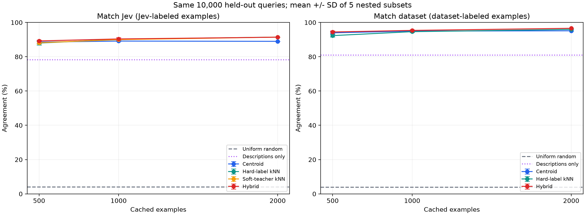
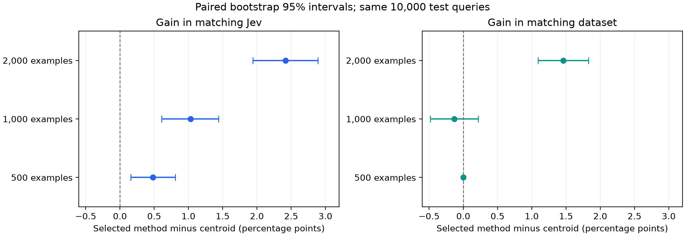

# 固定EmbeddingによるJev判定の近似：漏洩を防いだ10,000件比較

## 要旨

Jevを見本のラベル付けに使い、その見本をEmbeddingGemma 2で埋め込むと、
新しい入力をJev APIなしでどこまで同じように分類できるかを検証した。
英語の合成問い合わせ27分類で、見本500・1,000・2,000件を比較し、
すべての条件に共通の未使用テスト10,000件を使用した。
**主指標はJev直接判定との一致率**である。
既存データセットラベルとの一致率は別の指標として併記した。

事前指定した主比較（Jev見本1,000件）では、カテゴリ平均の
89.39%に対し、調整用データで選んだ近傍＋平均/説明の混合は
90.42%で、差は+1.03ポイントだった。
一様ランダム分類のJev一致率は3.94%。
モデルの重み更新・勾配学習・追加ヘッドの学習は行っていない。

## 1. 研究課題と指標

第一の問いは「Jevが見本を分類し、固定Embeddingと検索で未使用入力のJev判定を再現できるか」。
ここではJevの直接判定を教師の目標とし、一致率・Macro F1・Cohenのκを測定する。
Jev自身が正しいかどうかを測る指標とは区別する。

第二の問いは「既存ラベル付き見本をEmbeddingにするだけでデータセットの分類を再現できるか」。
既存ラベルを持つ同じ見本を使い、データセットラベルとの一致率を測定する。
データセットは合成データであり、そのラベルを人が独立に検証した正解とは扱わない。

## 2. データと分割

データは[Bitext Customer Support](https://huggingface.co/datasets/bitext/Bitext-customer-support-llm-chatbot-training-dataset)。
コミット`430d1a89bd93bd1fa23c16f29dd53e73f0087443`のCSV26,872行、27 intent、11 category。
本文は`instruction`だけを使用し、回答文・intent・categoryをモデルへ渡さない。
完全なメールのデータではなく、短い英語の合成問い合わせである。ライセンスはCDLA-Sharing-1.0。

Unicode NFKC、大小文字統一、句読点除去、プレースホルダ置換後の完全重複を除き、
23,826件が残った。
最初の予備実験で結果を見た2,500件は、本実験の見本・調整・テストからすべて除いた。
新しいランダムseed `20261008`で次の分割を先に固定した。

| 分割 | 件数 | 用途 |
| --- | ---: | --- |
| 見本バンク | 2,000 | Jevラベル版と既存ラベル版の両方で共有 |
| 調整用 | 1,000 | 設定選択。Jev一致率／既存ラベル一致率をそれぞれ目的にする |
| テスト | 10,000 | 最終評価のみ。全条件で共通 |

文字3〜5-gram TF-IDFによるコサイン類似度0.90以上の近似文も分割境界で除外した。
調整用は見本＋予備実験データとの近似文を376件、
テストは見本＋調整用＋予備実験データとの近似文を
4,447件除外した。
最大の交差分割類似度は調整用0.899280、
テスト0.899983。
TF-IDFは分割の検査だけに使い、分類器には使わない。

見本500・1,000件は2,000件バンクの先頭部分を使う入れ子の集合。
抽出のばらつきも確認するため、同じバンクの並べ替え5通りを使用した。
最大2,000件では同じバンクをすべて使うため、5つの独立データセットではない。

## 3. 漏洩防止と事前固定

- 見本・調整・テストの行IDは互いに素で、予備実験2,500件とも交差しない。
- 見本に保存するのは見本の本文Embeddingと、見本のラベルまたはJev確率分布だけ。
  調整用・テストの入力やラベルを見本キャッシュへ追加しない。
- テストの既存ラベルは別ファイルに分離し、設定選択コードは読み込まない。
- テストのJev分類・Embeddingを作る前に、全設定を確定した。
- `[protocol.json](protocol.json)`は分割・指標・探索候補を記録し、
  `[frozen.json](frozen.json)`は採用設定、設定固定時刻、コードと入力のSHA-256を保存する。
- 固定時刻は`2026-10-08T10:08:57.506659+00:00`、最終評価時刻は`2026-10-08T10:14:35.023649+00:00`。
  固定後にコードや入力が変わると最終評価コードは停止する。
- テスト結果を見た後の設定変更・候補説明の書き直し・再選択は行っていない。

これは行重複、定義した近似文、設定選択による漏洩を防ぐ設計である。
未知の生成テンプレート全体を分離できた保証や、事前学習にこの公開データが含まれない保証はない。

## 4. モデルと分類方式

Embeddingは[EmbeddingGemma 2](https://huggingface.co/google/embeddinggemma-2)のtext-only構成、
768次元、BF16。コミット`914f7f89142e33e77833254d9c9b90c3cef7303b`に固定した。
本文と候補説明には公式の対称な分類プレフィックス
`task: classification | query:`を付け、ベクトルを長さ1に正規化する。
Jevは`jev-1.13.0`、全リクエストで同じ27候補説明と判断指示を使用する。

| 方式 | 仕組み |
| --- | --- |
| 一様ランダム | 27候補を等確率で選ぶ。固定seedと100 seed平均を報告 |
| 比率ランダム | 見本のラベル比率でランダムに選ぶ |
| 最多カテゴリ | 見本で最も多いラベルを全件に返す |
| 説明文のみ | 入力と27候補の説明Embeddingを比較 |
| 1近傍 | 最も近い1件の見本ラベルを返す |
| カテゴリ平均 | ラベルごとに見本ベクトルを平均・正規化し、入力との類似度を比較 |
| 複数近傍投票 | 近いk件にコサイン類似度のsoftmax重みを付けてラベルを投票 |
| 低確信の見本を除く平均 | Jevのconfidenceがしきい値以上の見本で平均。消える分類は未フィルタ平均に戻す |
| 全確率の近傍 | Jevのargmaxだけでなく、見本の全27候補の確率分布を重み付きで平均 |
| 混合 | 近傍の分布と、平均ベクトル／候補説明から得た相対重みを混ぜる |

全確率の近傍は、入力q、見本s_i、Jev分布P_iに対して
`w_i = softmax(cos(E(q), E(s_i))/T)`、`V(q) = Σ w_i P_i`を計算する。
既存ラベル版ではP_iをone-hotとする。
混合方式は`(1−α)V(q) + α softmax(prior_similarity/τ)`を使う。
校正済みの正解確率とは主張しない。入力はモデルに1回通し、残りはベクトル計算だけである。

近傍数`1/3/5/9/15/31/63`、温度`0.02/0.05/0.1/0.2`、
confidenceしきい値`0/0.5/0.7/0.8/0.9/0.95`、
混合比`0/0.25/0.5/0.75/1`、事前重み温度`0.01/0.03/0.07/0.15`を探索した。
見本の件数・並べ替え・ラベル源ごとに、調整用の主指標だけで選択した。
同点は固定された探索順で解決する。
「改善方式」は調整用で選ばれた方式を意味し、テストでの改善を保証する呼び名ではない。

## 5. 主結果：10,000件での比較

まず、全条件共通の基準を示す。

| 基準 | Jevとの一致率 | データセットラベルとの一致率 |
| --- | ---: | ---: |
| 一様ランダム・固定seed | 3.94% | 3.87% |
| 候補説明文のみ | 78.23% | 80.97% |
| Jev直接判定 | 100.00% | 91.20% |

一様ランダムの期待一致率は1/27 = 3.70%。
100 seedでのJev一致率は平均3.71%、
標準偏差0.202ポイントだった。

| 見本のラベル源 | 見本数 | 平均方式：Jev一致 | 選択方式：Jev一致 | 平均方式：既存ラベル一致 | 選択方式：既存ラベル一致 | 調整用で選んだ方式 |
| --- | ---: | ---: | ---: | ---: | ---: | --- |
| Jev | 500 | 89.14% | 89.62% | 90.07% | 89.89% | 近傍＋平均/説明の混合 |
| Jev | 1,000 | 89.39% | 90.42% | 92.27% | 91.67% | 近傍＋平均/説明の混合 |
| Jev | 2,000 | 88.99% | 91.41% | 92.62% | 91.55% | 近傍＋平均/説明の混合 |
| 既存ラベル | 500 | 87.94% | 87.94% | 94.71% | 94.71% | カテゴリ平均 |
| 既存ラベル | 1,000 | 88.27% | 87.80% | 95.20% | 95.07% | 近傍＋平均/説明の混合 |
| 既存ラベル | 2,000 | 88.36% | 88.90% | 95.14% | 96.60% | 近傍＋平均/説明の混合 |

ここは主並べ替えseed 0の結果。Jevラベル版はJev一致率を目的に、
既存ラベル版は既存ラベル一致率を目的に設定を選んでいる。
両列を同じ目的に最適化した結果として解釈しない。



## 6. 全方式の比較

失敗した改善候補やランダム分類も含め、全方式を掲載する。

| ラベル源 | 見本数 | 方式 | Jev一致率 | 既存ラベル一致率 | Jev Macro F1 | 既存ラベル Macro F1 |
| --- | ---: | --- | ---: | ---: | ---: | ---: |
| Jev | 500 | 1近傍 | 86.61% | 84.64% | 0.8615 | 0.8403 |
| Jev | 500 | カテゴリ平均 | 89.14% | 90.07% | 0.8886 | 0.8956 |
| Jev | 500 | 複数近傍の投票 | 88.67% | 86.70% | 0.8825 | 0.8601 |
| Jev | 500 | 低確信の見本を除く平均 | 89.07% | 90.75% | 0.8869 | 0.9032 |
| Jev | 500 | Jevの全確率を使う近傍 | 88.89% | 87.68% | 0.8853 | 0.8694 |
| Jev | 500 | 近傍＋平均/説明の混合 | 89.62% | 89.89% | 0.8930 | 0.8933 |
| Jev | 500 | 見本の最多カテゴリ | 3.05% | 3.27% | 0.0022 | 0.0023 |
| Jev | 500 | 見本の比率でランダム分類 | 3.74% | 3.70% | 0.0352 | 0.0350 |
| Jev | 1,000 | 1近傍 | 88.70% | 86.94% | 0.8833 | 0.8640 |
| Jev | 1,000 | カテゴリ平均 | 89.39% | 92.27% | 0.8903 | 0.9199 |
| Jev | 1,000 | 複数近傍の投票 | 90.21% | 88.32% | 0.8985 | 0.8776 |
| Jev | 1,000 | 低確信の見本を除く平均 | 89.38% | 92.14% | 0.8899 | 0.9180 |
| Jev | 1,000 | Jevの全確率を使う近傍 | 90.13% | 89.15% | 0.8970 | 0.8854 |
| Jev | 1,000 | 近傍＋平均/説明の混合 | 90.42% | 91.67% | 0.8996 | 0.9113 |
| Jev | 1,000 | 見本の最多カテゴリ | 5.42% | 4.62% | 0.0038 | 0.0033 |
| Jev | 1,000 | 見本の比率でランダム分類 | 3.75% | 3.85% | 0.0357 | 0.0369 |
| Jev | 2,000 | 1近傍 | 90.68% | 88.37% | 0.9046 | 0.8798 |
| Jev | 2,000 | カテゴリ平均 | 88.99% | 92.62% | 0.8855 | 0.9244 |
| Jev | 2,000 | 複数近傍の投票 | 91.47% | 89.39% | 0.9120 | 0.8897 |
| Jev | 2,000 | 低確信の見本を除く平均 | 88.98% | 93.09% | 0.8848 | 0.9288 |
| Jev | 2,000 | Jevの全確率を使う近傍 | 91.46% | 90.60% | 0.9110 | 0.9006 |
| Jev | 2,000 | 近傍＋平均/説明の混合 | 91.41% | 91.55% | 0.9109 | 0.9105 |
| Jev | 2,000 | 見本の最多カテゴリ | 5.42% | 4.62% | 0.0038 | 0.0033 |
| Jev | 2,000 | 見本の比率でランダム分類 | 3.71% | 3.67% | 0.0350 | 0.0350 |
| 既存ラベル | 500 | 1近傍 | 84.73% | 91.53% | 0.8392 | 0.9104 |
| 既存ラベル | 500 | カテゴリ平均 | 87.94% | 94.71% | 0.8745 | 0.9450 |
| 既存ラベル | 500 | 複数近傍の投票 | 85.87% | 93.03% | 0.8519 | 0.9251 |
| 既存ラベル | 500 | 近傍＋平均/説明の混合 | 87.88% | 94.70% | 0.8739 | 0.9449 |
| 既存ラベル | 500 | 見本の最多カテゴリ | 3.05% | 3.27% | 0.0022 | 0.0023 |
| 既存ラベル | 500 | 見本の比率でランダム分類 | 3.80% | 3.90% | 0.0365 | 0.0374 |
| 既存ラベル | 1,000 | 1近傍 | 86.54% | 93.74% | 0.8581 | 0.9336 |
| 既存ラベル | 1,000 | カテゴリ平均 | 88.27% | 95.20% | 0.8777 | 0.9499 |
| 既存ラベル | 1,000 | 複数近傍の投票 | 87.70% | 94.97% | 0.8709 | 0.9463 |
| 既存ラベル | 1,000 | 近傍＋平均/説明の混合 | 87.80% | 95.07% | 0.8722 | 0.9475 |
| 既存ラベル | 1,000 | 見本の最多カテゴリ | 3.05% | 3.27% | 0.0022 | 0.0023 |
| 既存ラベル | 1,000 | 見本の比率でランダム分類 | 3.93% | 3.98% | 0.0371 | 0.0375 |
| 既存ラベル | 2,000 | 1近傍 | 88.42% | 95.98% | 0.8788 | 0.9580 |
| 既存ラベル | 2,000 | カテゴリ平均 | 88.36% | 95.14% | 0.8791 | 0.9492 |
| 既存ラベル | 2,000 | 複数近傍の投票 | 88.38% | 95.95% | 0.8782 | 0.9576 |
| 既存ラベル | 2,000 | 近傍＋平均/説明の混合 | 88.90% | 96.60% | 0.8836 | 0.9643 |
| 既存ラベル | 2,000 | 見本の最多カテゴリ | 3.72% | 3.72% | 0.0027 | 0.0027 |
| 既存ラベル | 2,000 | 見本の比率でランダム分類 | 3.60% | 3.66% | 0.0347 | 0.0353 |

## 7. 不確実性と対比較

各一致率の95% Wilson区間、Cohenのκ、大分類一致率は[results.json](results.json)に保存した。
採用方式とカテゴリ平均を**同じテスト行**で比較し、
差のbootstrap 10,000回の95%区間とexact McNemar検定を求めた。
6つの事前指定した比較についてHolm補正したp値も示す。
Jev源は教師判定を、既存ラベル源はデータセットラベルを評価目標とする。

| ラベル源 | 見本数 | 差（ポイント） | 95%区間 | 選択方式のみ一致 | 平均方式のみ一致 | Holm補正p |
| --- | ---: | ---: | --- | ---: | ---: | ---: |
| jev | 500 | +0.48 | [+0.16, +0.81] | 164 | 116 | 0.0147 |
| jev | 1,000 | +1.03 | [+0.61, +1.44] | 279 | 176 | 6.3e-06 |
| jev | 2,000 | +2.42 | [+1.94, +2.89] | 415 | 173 | 3.84e-23 |
| dataset | 500 | +0.00 | [+0.00, +0.00] | 0 | 0 | 1 |
| dataset | 1,000 | -0.13 | [-0.48, +0.22] | 152 | 165 | 1 |
| dataset | 2,000 | +1.46 | [+1.09, +1.83] | 249 | 103 | 2.2e-14 |

主比較はJev源・1,000件。その他は副次的比較である。


行単位の区間・検定はテスト行の独立性を仮定し、
合成テンプレート由来の相関や未知分野への分布変化は扱っていない。
小さなp値だけで実メールでも同じ改善があるとは解釈しない。

## 8. 見本抽出のばらつき

同じ2,000件バンクの並べ替え5通りの平均 ± 標準偏差（ポイント）。
同じテスト集合を使い、各方式の設定はそれぞれ調整用で選んだ。
ここでは選択の結果によらず、平均方式と混合方式を固定して比較する。

| ラベル源 | 見本数 | 方式 | Jev一致率：平均±SD | 既存ラベル一致率：平均±SD |
| --- | ---: | --- | ---: | ---: |
| jev | 500 | カテゴリ平均 | 88.56 ± 0.76 | 90.21 ± 1.26 |
| jev | 500 | 近傍＋平均/説明の混合 | 89.23 ± 0.47 | 90.56 ± 1.09 |
| dataset | 500 | カテゴリ平均 | 87.47 ± 0.31 | 93.95 ± 0.72 |
| dataset | 500 | 近傍＋平均/説明の混合 | 87.64 ± 0.39 | 94.44 ± 0.60 |
| jev | 1,000 | カテゴリ平均 | 89.15 ± 0.27 | 92.26 ± 0.55 |
| jev | 1,000 | 近傍＋平均/説明の混合 | 90.38 ± 0.73 | 91.19 ± 0.70 |
| dataset | 1,000 | カテゴリ平均 | 88.19 ± 0.21 | 94.99 ± 0.24 |
| dataset | 1,000 | 近傍＋平均/説明の混合 | 88.18 ± 0.51 | 95.37 ± 0.37 |
| jev | 2,000 | カテゴリ平均 | 88.99 ± 0.00 | 92.62 ± 0.00 |
| jev | 2,000 | 近傍＋平均/説明の混合 | 91.41 ± 0.00 | 91.55 ± 0.00 |
| dataset | 2,000 | カテゴリ平均 | 88.36 ± 0.00 | 95.14 ± 0.00 |
| dataset | 2,000 | 近傍＋平均/説明の混合 | 88.90 ± 0.00 | 96.60 ± 0.00 |

最大2,000件では同じ見本集合であるため、このSDは独立な抽出実験の不確実性ではない。

## 9. 再現用ファイルと料金

- [protocol.json](protocol.json): 分割ID、seed、説明文、探索候補、モデルバージョン。
- [frozen.json](frozen.json): テスト前に固定した設定とハッシュ。
- [results.json](results.json) / [metrics.csv](metrics.csv): 全方式・全並べ替えの数値。
- `predictions.csv`（ローカルのみ・Git対象外）: 10,000行のJev判定・既存ラベル・各方式予測。
- [per_class.json](per_class.json): 主並べ替えの各分類ごとの指標と混同行列。
- [runtime-development.json](runtime-development.json) / [runtime-test.json](runtime-test.json): 実行環境。
- [spending.json](spending.json): 予備実験から通算したAPI使用量。

本実験は見本2,000＋調整1,000＋テスト10,000件の13,000件をJevに直接分類させた。
予備実験2,000呼び出しを含めた台帳は15,000成功呼び出し、
15,785,361 input tokens。
[公式料金](https://docs.typesafe.ai/models)からの通算料金推計は
**$0.662985**。
提供者の請求明細を照合した金額ではない。
各試行前の最大料金予約・不明な応答の予約保持を含め、通算上限$4を維持した。

生データ・生APIレスポンス・Embeddingは`.cache/paper/`、
API台帳は`.cache/experiment/jev-ledger.sqlite3`に保存する。
データセット本体・生レスポンス・ベクトル・行ごとの予測・APIキーはGit対象外。
Gitにはコード、集計結果、図、分割IDと設定の再現用メタデータを含める。
保存済みレスポンスは同じ要求の再実行で再利用する。

```bash
uv pip install --python .venv/bin/python -e '.[model,dev,experiment]'
export HF_HOME="$PWD/.cache/huggingface"
# 元CSVがなければ予備実験のprepareだけでダウンロードする（API呼び出しなし）
.venv/bin/python -m experiments.email_routing --stage prepare
# 既存の固定済み実験を上書きしないため、再現には別のwork/reportを指定する
.venv/bin/python -m experiments.paper_protocol --stage all \
  --work .cache/reproduction --report reports/reproduction --budget-usd 4
```

`all`のlabel段階は課金される。固定済みの本実験を確認する場合は保存済みファイルを使う。
`--stage prepare/embed_development/label_development/tune/label_test/embed_test/evaluate`で段階実行も可能。
最終評価の再現は固定した設定をそのまま使い、再調整しない。
Jevの再呼び出しが同一結果になる保証はないので、保存済みレスポンスを保持する。

## 10. 限界と論文で主張できる範囲

この結果は、指定した公開データ・教師バージョン・固定Embedding・見本バンクでの判定近似を示す。
「Jevと同じ知能」「確率まで校正された代替」「日本語の実メールでも同じ性能」
「生成テンプレート全体を分けた未知ドメイン評価」とは主張できない。
画像・音声・複数用件のメール・未知カテゴリは本実験の対象外である。
モデル本体は小型化しておらず、量子化も行っていない。
データセットラベルとの一致率とJev判定との一致率は、別々の目標として記述する必要がある。

## 付録：主並べ替えで固定した選択設定

```json
[
  {
    "source": "jev",
    "support_size": 500,
    "selected_method": "hybrid",
    "configuration": {
      "kind": "hybrid",
      "parent": "soft_knn",
      "k": 15,
      "temperature": 0.05,
      "prior": "centroid",
      "prior_temperature": 0.03,
      "alpha": 0.5,
      "validation_primary_score": 0.903
    }
  },
  {
    "source": "dataset",
    "support_size": 500,
    "selected_method": "centroid",
    "configuration": {
      "kind": "centroid",
      "validation_primary_score": 0.94
    }
  },
  {
    "source": "jev",
    "support_size": 1000,
    "selected_method": "hybrid",
    "configuration": {
      "kind": "hybrid",
      "parent": "soft_knn",
      "k": 15,
      "temperature": 0.02,
      "prior": "centroid",
      "prior_temperature": 0.03,
      "alpha": 0.5,
      "validation_primary_score": 0.92
    }
  },
  {
    "source": "dataset",
    "support_size": 1000,
    "selected_method": "hybrid",
    "configuration": {
      "kind": "hybrid",
      "parent": "weighted_knn",
      "k": 63,
      "temperature": 0.05,
      "prior": "description",
      "prior_temperature": 0.15,
      "alpha": 0.75,
      "validation_primary_score": 0.955
    }
  },
  {
    "source": "jev",
    "support_size": 2000,
    "selected_method": "hybrid",
    "configuration": {
      "kind": "hybrid",
      "parent": "soft_knn",
      "k": 9,
      "temperature": 0.05,
      "prior": "centroid",
      "prior_temperature": 0.07,
      "alpha": 0.5,
      "validation_primary_score": 0.927
    }
  },
  {
    "source": "dataset",
    "support_size": 2000,
    "selected_method": "hybrid",
    "configuration": {
      "kind": "hybrid",
      "parent": "weighted_knn",
      "k": 15,
      "temperature": 0.02,
      "prior": "centroid",
      "prior_temperature": 0.01,
      "alpha": 0.25,
      "validation_primary_score": 0.968
    }
  }
]
```
